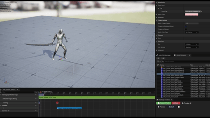
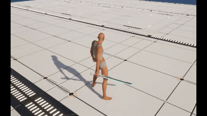
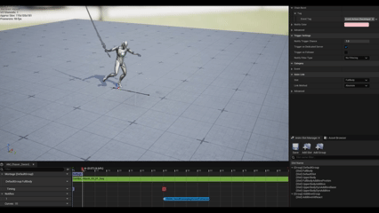
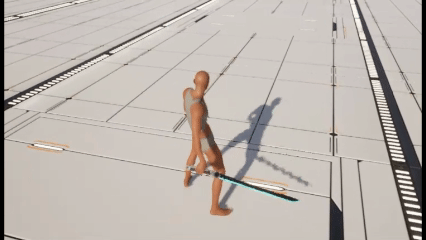
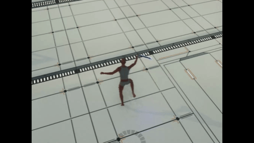
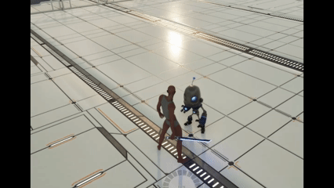

## 2 어빌리티 아키텍처

### 2.1 어빌리티 계층 구조와 기능 조각 (`Fragment`)

발동 방식(입력 · 이벤트 · AI 두뇌)은 상속 계층으로 분리하고, 여러 어빌리티가 공통으로 사용하는 공격 판정 기능은 기능 조각(`Fragment`)으로 분리해 필요한 어빌리티가 멤버로 소유·호출하는 구조임.

| 클래스 | 실행 정책 | 주요 역할 |
|---|---|---|
| `UCBGameplayAbility` | — | 모든 어빌리티의 루트. 활성화 정책(`OnTrigger` / `OnGiven`), 사망 상태 차단 게이트(`bActivatableWhileDead`), 차단 무시(`bIgnoreAbilityBlocking`) 등 공용 규칙 담당 |
| `UCBActionAbility` | — | 몽타주 액션 공통 베이스. `GameplayCue`를 통한 몽타주 재생·정지·섹션 점프 동기화 및 종료 처리 |
| `UCBInputActionAbility` | `LocalPredicted` | 입력 태그(`BoundInputTag`)로 발동하고, 노티파이 구간(`CheckInput`)에서 다음 입력을 감지해 재활성화 |
| `UCBEventActionAbility` | `ServerInitiated` | 게임플레이 이벤트 트리거로 자동 발동 (피격 `UCBHitReactAbility`, 사망 `UCBDeathAbility`) |
| `UCBChaserAttackAbility` | `LocalPredicted` | 플레이어 공격 어빌리티. 콤보 전진·롤백, 발동 시 조준 방향 정렬 + `WeaponTrace` 조각 사용 |
| `UCBAIAttackAbility` | `ServerOnly` | AI 공격 어빌리티. BT 태스크 직접 활성화, 무작위 몽타주 선택, 타겟 모션 워핑 + 3종 공격 조각 사용 |

#### 공격 기능 조각 (`UObject Fragment`)
- **도입 이유**: 플레이어 공격(입력 기반)과 AI 공격(BT 기반)은 부모 클래스가 달라 상속으로는 무기 트레이스·데미지 로직을 공유할 수 없음. 판정 기능을 독립된 `UObject` 서브오브젝트 조각으로 분리해, 각 공격 어빌리티가 필요한 조각을 멤버로 소유(`Instanced, NoClear`)하고 수명 시점(`CanActivateAbility` / `ActivateAbility` / `EndAbility`)마다 직접 호출하도록 구성함.
- **데미지 적용 일원화**: 판정 방식만 조각별로 다르고, 적중한 타겟에 데미지 스펙을 만들어 적용하는 로직은 공용 함수(`UCBAbilitySystemLibrary::Auth_ApplyDamageToTarget`)를 함께 사용함.

| 기능 조각 클래스 | 역할 | 사용 어빌리티 |
|---|---|---|
| `UCBFragment_WeaponTrace` | 무기 보유 검사(`CanActivate`), 로컬 트레이스 구간 on/off(`Start`/`Stop`), 서버 히트 수신(`Event.Combat.Attack.Hit`) 및 데미지 GE·피격 큐 적용 | `UCBChaserAttackAbility` `UCBAIAttackAbility` |
| `UCBFragment_AreaAttack` | `Event.Combat.AreaAttack` 수신 시 서버에서 시전자 기준 회전 박스 오버랩 + 벽 차단 라인 트레이스 검사 후 범위 내 타겟에 데미지 GE·피격 큐 적용 (→ [6.8 영역 공격](06-combat-system.md#68-영역-공격-ucbfragment_areaattack)) | `UCBAIAttackAbility` |
| `UCBFragment_Projectile` | `Event.Combat.FireProjectile` 수신마다 타겟 현재 위치를 재조준하고, 데미지 스펙을 생성해 지정 소켓에서 부채꼴(`ProjectileCount`, `SpreadAngle`)로 투사체(`ACBProjectile`) 스폰·발사 (→ [6.9 투사체 공격](06-combat-system.md#69-투사체-공격-ucbfragment_projectile--acbprojectile)) | `UCBAIAttackAbility` |

---

### 2.2 태그 이벤트 노티파이 · 노티파이 스테이트

몽타주 타임라인에 배치한 노티파이가 ASC로 게임플레이 이벤트(`Event.*`)를 보내 어빌리티와 기능 조각의 동작 타이밍을 제어함.

| 클래스 | 종류 | 주요 역할 및 이벤트 태그 |
|---|---|---|
| `UCBAN_SendGameplayEventToOwner` | 단발 노티파이 (`UAnimNotify`) | 지정 프레임에 이벤트 태그 전송 (로컬 컨트롤 폰에서 전송 + 클라이언트는 서버 RPC 전달) • `Event.Action.EndAbility`: 어빌리티 조기 종료 • `Event.Action.CheckInput`: 콤보 입력 감지 시작 • `Event.Combat.AreaAttack`: 영역 공격 판정 실행 • `Event.Combat.FireProjectile`: 투사체 발사 (여러 개 배치 시 연사) |
| `UCBANS_GameplayEventWindow` | 구간 노티파이 스테이트 (`UAnimNotifyState`) | 구간 시작에 `StartEventTag`, 끝에 `EndEventTag`를 로컬 컨트롤 폰에게 전송 • 기본값: `Event.Combat.TraceStart` / `Event.Combat.TraceEnd` (무기 트레이스 활성 구간) |

#### 💡 여러 노티파이 조합을 통한 몽타주 연출
하나의 몽타주 안에서 **트레이스 활성 구간 + 입력 감지 시점 + 어빌리티 조기 종료 시점**을 에디터 타임라인만으로 설정할 수 있음.

---

### 2.3 액션 어빌리티 실행 흐름 (`UCBActionAbility`)

모든 액션(몽타주) 어빌리티가 공유하는 재생 → 종료 골격임.

- **몽타주 동기화 재생**: 몽타주를 직접 재생하지 않고 액션 태그와 재생 인덱스를 파라미터로 담아 `GameplayCue.PlayAction`을 실행해 전 클라이언트가 동일한 몽타주를 재생함.
- **3가지 종료 경로** (어느 경로로 끝나든 `CleanupActionState()`를 호출해 자식 상태를 정리함)
  - **정상 종료 (`OnActionEnded`)**: 노티파이가 보낸 `Event.Action.EndAbility` 수신 → `StopAction` 큐로 몽타주 정지 후 종료
  - **블렌드 아웃 종료 (`OnActionMontageBlendingOut`)**: `UCBAbilityTask_WaitMontageBlendOut`으로 자기 몽타주 인스턴스 ID의 블렌드 아웃 시작을 감지해 종료 (노티파이가 없거나 공격 속도가 변해도 정확히 종료되며, 다른 몽타주에 끊기면 캔슬 종료)
  - **캔슬 종료 (`EndAbility(bWasCancelled)`)**: 피격·사망 등으로 끊긴 경우 서버에서 몽타주 정지를 요청하고 상태 정리
- **자식 확장 지점**
  - `SelectActionMontageIndex()`: 재생 인덱스 결정 (콤보 전진 · 무작위 선택 · 상태 분기)
  - `BuildActionCueParameters()`: 큐 파라미터 추가 데이터 탑재 (모션 워핑 타겟 등)
  - `OnActionMontageStarted()`: 재생 직후 후처리 (입력 확인 대기 등록 등)
  - `CleanupActionState()`: 종료·캔슬 시 자식 상태 정리
  - `ShouldStopActionOnEnd()`: 사망처럼 마지막 프레임을 유지할지 여부

#### 💡 `Event.Action.EndAbility` 태그 이벤트
후딜레이 모션이 긴 몽타주의 원하는 지점에 노티파이를 배치해 어빌리티를 조기 종료할 수 있음.

---

### 2.4 입력 액션 어빌리티 (`UCBInputActionAbility`)

입력 태그(`BoundInputTag`)로 발동하고, 몽타주 중간의 노티파이 시점부터 다음 입력을 감지해 재활성화하는 어빌리티임 (`LocalPredicted`).

- 몽타주 재생(`PlayActionMontage`)은 자식이 전투 상태·쿨다운 등 조건을 검사한 뒤 호출함.
- 입력 감지는 직접 조종하는 로컬 캐릭터(`IsLocallyControlled`)에서만 수행하며, `Event.Action.CheckInput` 수신 시점의 입력 상태에 따라 분기함.
  - **입력을 누르고 있으면**: 즉시 `EndAbility` 후 `TryActivateAbility`를 호출해 끊김 없이 다음 액션(콤보)으로 이어짐
  - **입력이 없으면**: 입력 대기 윈도우(`bWaitingForInput`)를 열어두고, 몽타주 종료 전에 입력이 들어오면 재활성화 / 끝까지 없으면 몽타주와 함께 종료

#### 💡 `Event.Action.CheckInput` 태그 이벤트
몽타주의 원하는 지점부터 입력을 감지해 홀드 연타 또는 후속 입력으로 재활성화함.

---

### 2.5 Chaser 공격 어빌리티 (`UCBChaserAttackAbility`)

입력 액션 어빌리티에 콤보 전진·조준 방향 정렬과 `WeaponTrace` 조각을 조립한 클래스임 (`LocalPredicted`).

- **발동 검사 및 정렬**: `CanActivateAbility`에서 무기 보유(`WeaponTrace->CanActivate`)를 검사하고, 활성화 시 전투 모드·쿨다운(`CommitAbility`) 확인 후 조준 방향(`bAlignToAimOnActivate`)으로 캐릭터를 즉시 정렬함.
- **콤보 전진과 롤백**: `IsCombo`가 켜져 있으면 예측키와 함께 콤보 인덱스를 전진(`AdvanceCombo`)시키고, 서버가 활성화를 거부하면 해당 전진만 되돌림(`RollbackCombo`). 액션 종료 시 `CleanupActionState()`에서 `ResetCombo()`로 체인을 닫음.
- **`WeaponTrace` 조각 구동**: 몽타주 재생 직후 `WeaponTrace->Start()`를 호출해 로컬에서는 `GameplayEventWindow`(`TraceStart`/`TraceEnd`) 구간 동안 무기 트레이스를 켜고 끄며, 서버에서는 `Event.Combat.Attack.Hit`을 받아 데미지 GE와 피격 큐를 적용함. `EndAbility`에서는 `WeaponTrace->Stop()`으로 트레이스를 강제 정지함.

> 🔎 트레이스 감지 및 데미지 검증 구조는 [6. 전투 시스템](06-combat-system.md) 참고

---

### 2.6 AI 공격 어빌리티 (`UCBAIAttackAbility`)

BT 태스크(`UCBBTTask_ActivateAbility` / `AndWait`)가 직접 활성화하고 서버에서만 실행하는 클래스임 (`ServerOnly`).

- **변형 몽타주 추첨 및 모션 워핑**: `bRandomizeMontage` 설정 시 서버에서 1회 무작위 인덱스를 뽑아 큐로 전파해 전 클라이언트가 같은 모션을 재생하며, 블랙보드의 추격 타겟을 큐 파라미터에 실어 `WarpStopDistance`만큼 남기고 접근함.
- **3종 공격 기능 조각 통합 구동**: `WeaponTrace`, `AreaAttack`, `Projectile` 세 조각을 모두 보유하고 몽타주 재생 직후 `Start()`를 호출함. 세 조각 모두 노티파이 이벤트가 올 때만 동작하므로, **몽타주에 배치된 노티파이 종류만으로 근접 · 광역 · 원거리 · 복합 공격이 결정됨.**

#### 💡 `UCBANS_GameplayEventWindow` 트레이스 구간 설정
몽타주의 원하는 구간에서 `Event.Combat.TraceStart` / `TraceEnd` 이벤트를 보내 무기 트레이스를 활성화함.

> 🔎 트레이스 관련 자세한 내용은 [6. 전투 시스템](06-combat-system.md) 참고

---

### 2.7 이벤트 액션 어빌리티 (`UCBEventActionAbility`)

입력이 아니라 서버가 발행한 게임플레이 이벤트로 자동 발동하는 어빌리티임 (`ServerInitiated`).

- 자식 생성자에서 `RegisterEventTrigger()`로 발동 이벤트 태그를 등록하고, 발동 시 `CancelAbilityTag`에 해당하는 진행 중 어빌리티를 취소한 뒤 몽타주를 재생함.
- **피격 (`UCBHitReactAbility`)**: `Event.Combat.HitReact`로 발동(재발동 허용). 휘두르던 공격(`Ability.Combat.Attack`)을 캔슬하고 전투/비전투 인덱스에 맞는 피격 모션을 재생함. 슈퍼아머(`Status.Combat.SuperArmor`) 상태이거나 연쇄 경직 한도 시간을 초과한 경우에는 발동을 차단하며, AI는 GAS 루트모션 소스(`ConstantForce`)로 타격 반대 방향 넉백을 적용함.
- **사망 (`UCBDeathAbility`)**: `Event.Combat.Death`로 발동. 차단 무시(`bIgnoreAbilityBlocking`)로 시전 중에도 반드시 발동하며, 모든 어빌리티를 캔슬한 뒤 몽타주보다 먼저 사망 GE(`Status.Dead`)를 적용함. `ShouldStopActionOnEnd() = false`로 마지막 시체 포즈를 유지함.

