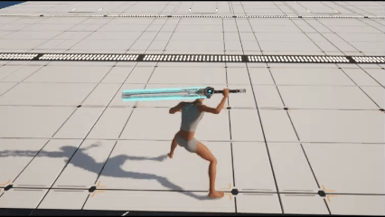
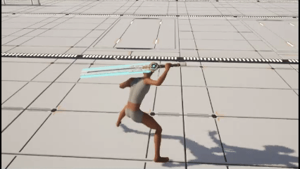

## 3 액션 시스템

### 3.1 액션 시스템 구조

캐릭터가 사용하는 모든 몽타주를 데이터 에셋 한 곳에 모아두고, 액션 컴포넌트(`UCBActionComponent`)와 액션 어빌리티(`UCBActionAbility`)를 통해 태그 기반으로 재생·제어하는 구조.

- **데이터와 로직 분리**: 어빌리티는 몽타주 에셋을 직접 참조하지 않고 액션 태그(`Action.*`)와 인덱스만으로 재생을 요청함.
- **단일 + 배열 통합**: 하나의 액션 태그에 여러 몽타주를 배열로 등록할 수 있어 단일 액션, 콤보 공격, 랜덤 공격, 상태별(전투/비전투 · 개이트) 애니메이션을 동일한 구조로 처리함.
- **공격 속도 연동**: 엔트리마다 공격 속도 영향 여부(`bAffectedByAttackSpeed`)를 설정해, 재생 시 캐릭터의 `AttackSpeed` 어트리뷰트를 `PlayRate`와 블렌드 시간에 자동 반영함.
- **인스턴스 ID 추적**: 방금 재생한 몽타주의 인스턴스 ID(`LastMontageInstanceID`)를 기록해, 연속 공격이나 재발동 시에도 어빌리티가 자신이 재생한 몽타주 인스턴스만 정확히 감지함.

---

### 3.2 몽타주 데이터 에셋과 재생 흐름

**데이터 에셋(`UCBActionMontageData`)은 순수 조회 테이블이고, 인덱스는 호출자에서 정하며, 실제 조회와 재생은 각 머신의 액션 컴포넌트가 수행함.**

- **데이터 에셋 구성 (`FCBActionMontageEntry`)**: 에디터에서는 `(ActionTag, Montages[], bAffectedByAttackSpeed)` 배열로 편집하고, 로드(`PostLoad`) 시 `TMap<FGameplayTag, FCBActionMontageEntry>`로 변환해 $O(1)$로 조회함.
- **재생 흐름**
  1. **인덱스 결정**: 어빌리티가 상황에 맞는 인덱스(`SelectActionMontageIndex()`)를 결정함 (콤보 단계 · 무작위 선택 · 전투/개이트 상태 분기)
  2. **큐 전파**: 액션 태그와 결정된 인덱스를 큐 파라미터에 실어 `GameplayCue.PlayAction` 실행
  3. **로컬 조회 및 재생**: 서버 · 소유 클라 · 시뮬 프록시 각 머신의 액션 컴포넌트가 데이터 에셋에서 같은 인덱스의 몽타주를 찾아 재생
- **공격 속도(`PlayRate`) 및 블렌드 시간 보정**
  - `UCBActionComponent::PlayMontage`가 `bAffectedByAttackSpeed`가 켜진 몽타주에 한해 캐릭터의 `AttackSpeed` 어트리뷰트를 조회해 `PlayRate`로 적용함.
  - `UCBCharacterAnimInstance::PlayMontage`가 그 `PlayRate`로 블렌드 시간을 보정함. 몽타주 블렌드 인/아웃은 실제 시간(초) 기준으로 동작하므로, `PlayRate`가 빨라질 때 **블렌드 인/아웃 시간도 `1 / PlayRate` 비율로 함께 축소**함.

#### 💡 공격 속도 영향받는 몽타주 설정
공격 속도에 따라 빠르게 재생할 몽타주를 데이터 에셋에서 체크박스로 설정할 수 있음.

**공격속도 : `1.0`**

**공격속도 : `2.0`**

---

### 3.3 액션 어빌리티와 GameplayCue 동기화

어빌리티는 시뮬레이티드 프록시에서 실행되지 않으므로, 모든 머신에서 보여야 하는 몽타주 제어는 게임플레이 큐를 통해 동기화함.

| 게임플레이 큐 태그 | 노티파이 클래스 | 동기화 동작 |
|---|---|---|
| `GameplayCue.PlayAction` | `UCBGCN_PlayAction` | 큐 파라미터의 액션 태그 · 인덱스로 몽타주 재생 + 모션 워핑 타겟 등록 |
| `GameplayCue.StopAction` | `UCBGCN_StopAction` | 현재 재생 중인 액션 몽타주를 0.1초 블렌드 아웃으로 정지 (`RequestStopMontage(0.1f)` → `StopMontage`) |
| `GameplayCue.JumpActionSection` | `UCBGCN_JumpActionSection` | 지정한 몽타주가 재생 중일 때 목표 섹션으로 점프 (지연 도착 시 이미 지나간 섹션으로 되돌아가지 않도록 현재 재생 위치 검사 포함) |

- **모션 워핑 타겟 전달 (`UCBGCN_PlayAction`)**: 몽타주 재생 직전 큐 파라미터에 담긴 정보로 모션 워핑 타겟(이름 = `ActionTag`)을 함께 등록함.
  - **컴포넌트 추적 모드 (`TargetAttachComponent`)**: AI 공격이 타겟 캐릭터를 추적하며 `WarpStopDistance`(`NormalizedMagnitude`)만큼 앞에서 멈추도록 설정
  - **고정 좌표 · 방향 모드 (`Location` / `Normal`)**: 플레이어 대시 등 목표 지점과 회전이 확정된 액션에 사용
- **역할 분리**: 시뮬 프록시는 큐를 통해 몽타주 재생·정지·섹션 점프와 모션 워핑만 수행하며, 태그 이벤트 수신 · 무기 트레이스 · 데미지 계산 등 게임플레이 로직은 로컬과 서버에서만 처리함.