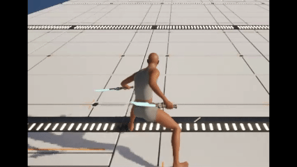

## 4 이동/로코모션 시스템

### 4.1 이동/로코모션 구조

입력과 어빌리티가 ASC 태그 및 CMC 이동 값을 갱신하면, 이동·회전 컴포넌트가 이를 읽어 가감속·회전·파생 태그를 실시간으로 처리하고 애님BP는 읽기 전용으로 상태 전환만 수행하는 구조임.

| 컴포넌트 | 역할 |
|---|---|
| `UCBLocomotionProcessor` (이동) | 개이트별 가속·감속 및 대시 전용 감속을 CMC에 반영하고, 파생 이동 태그(`Idle` · `InAir` · `Gait.Run`)를 로컬 미러링 |
| `UCBCharacterRotationComponent` (회전) | 개이트별 회전 기준(카메라 / 이동 방향) 및 보간 속도 적용, 목표 회전(`TargetRotation`) 복제, 공격 시 조준 회전 |
| `UCBInputManagerComponent` (입력) | 카메라 기준 이동 입력 적용, 급반전(피벗) 감지 및 이동 입력 잠금 ([5. 입력 시스템](05-input-system.md) 참고) |

---

### 4.2 개이트 태그

**이동 · 회전 · 애니메이션 · 액션 몽타주가 모두 같은 태그 하나를 읽음.**

- 개이트는 ASC 의 Status.Movement.Gait.* 태그로 표현하고, 항상 하나만 유지함.
  - **의도 개이트 (`Walk` · `Sprint`)**: 어빌리티(`UCBGAChangeSpeed`)가 활성 동안 GE로 개이트 태그와 이동 속도를 함께 부여하고, 종료 시 제거함.
  - **파생 개이트 (`Run`)**: 두 의도 태그가 모두 없을 때 `UCBLocomotionProcessor`가 부여해 항상 정확히 1개의 개이트 태그만 유지함.
  - 판별 우선순위(`Sprint > Walk > Run`)는 공용 헬퍼(`UCBAbilitySystemLibrary::GetCurrentGaitTag`) 하나로 통일했음.
    - 애님 인스턴스 · 회전 컴포넌트 · 입력 매니저 · 몽타주 인덱스 계산이 전부 같은 함수를 씀.

| 소비자 | 태그로 판별하는 것 |
|---|---|
| CMC | 최대 속도 · 가속 · 감속 |
| 회전 컴포넌트 | 회전 보간 속도, 회전 타겟(카메라 / 이동 방향) |
| ABP 상태 머신 | 개이트별 애니메이션 선택 |
| 액션(몽타주) | 개이트마다 다른 동작이 있는 액션의 재생 인덱스 |
---

### 4.3 무브먼트 데이터 에셋

**무브먼트 데이터 에셋 (`UCBCharacterMovementData` / `FCBGaitMovementData`)**
- 로드아웃이 캐릭터에 주입하며, 개이트 태그를 키로 **최대 속도(`MaxSpeed`) · 최대 가속도(`MaxAcceleration`) · 제동 감속도(`BrakingDeceleration`) · 회전 보간 속도(`RotationInterpSpeed`) · 피벗 각도 임계(`PivotAngleThreshold`) · 피벗 잠금 시간(`PivotInputLockDuration`)** 6가지 값을 한 곳에서 관리함.
- 데이터가 없거나 미설정된 항목은 각 컴포넌트의 기본값으로 동작하며, `UCBGAChangeSpeed`도 목표 개이트 속도가 0 이하이면 기존 개이트를 유지한 채 취소 종료함.

**개이트 태그 하나에 이동 관련 값이 묶여 있어서, 새 개이트를 추가하거나 캐릭터별로 감을 바꿀 때 코드를 건드리지 않음.**

| 값 | 쓰는 곳 | 비고 |
|---|---|---|
| 최대 속도 | 이동 속도 GE / CMC | 개이트 태그와 함께 부여 |
| 최대 가속도 | 로코모션 프로세서 → CMC | 클수록 목표 속도까지 빨리 붙음 |
| 제동 감속도 | 로코모션 프로세서 → CMC | 작을수록 오래 미끄러짐 (질주는 낮게) |
| 회전 보간 속도 | 회전 컴포넌트 | 작을수록 느리게 돌아감 (질주는 낮게) |
| 피벗 각도 임계 | 입력 매니저 | 낮을수록 민감 |
| 피벗 입력 잠금 시간 | 입력 매니저 | 질주는 길게 |

- 데이터 에셋은 **로드아웃이 캐릭터에 주입**하고 런타임에 교체되지 않으므로, 소비하는 쪽은 한 번만 캐싱해서 재사용함.
- 값이 없으면 각 컴포넌트의 기본값으로 동작함 - 에셋을 붙이지 않아도 캐릭터가 움직일 수 있도록 함.
---

### 4.4 로코모션 프로세서 (`UCBLocomotionProcessor`)

**이동 상태 태그의 관리자이면서, 개이트별 가속·감속을 CMC에 반영하는 컴포넌트.**

- **이동 상태 태그 로컬 미러링 (비복제 루스 태그)**
CMC 가 이미 복제되므로 서버 · 소유 클라 · 시뮬 프록시가 각자  로컬에서 값을 읽어서 동일한 비복제 태그를 부여·제거함. - **태그를 위한 네트워크 코드가 따로 없음.**

| 태그 | 갱신 방식 | 판정 |
|---|---|---|
| `Status.Movement.Idle` | 매 틱 (속도 기반) | 가속이 없고 수평 속도가 임계 이하. (진입/이탈 임계를 다르게 둔 **히스테리시스**로 경계에서 깜빡이지 않게 함) |
| `Status.Movement.InAir` | 무브먼트 모드 변경 이벤트 | 낙하 중인지 여부 (틱 불필요) |
| `Status.Movement.Gait.Run` | 개이트 태그 변경 이벤트 | Walk · Sprint 의도 태그가 둘 다 없으면 부여 |

---

### 4.5 캐릭터 회전 (`UCBCharacterRotationComponent`)

**개이트에 따라 바라보는 기준이 다르고, 네트워크에는 회전 결과가 아닌 목표 회전(`TargetRotation`)만 복제함.**

| 개이트 | 회전 타겟 | 이동 입력 적용 방식 (`Input_Move`) |
|---|---|---|
| `Walk` · `Run` | 카메라 방향 (`aim-facing`) | 캐릭터 정면 기준 전후 · 좌우 분해 (스트레이핑) |
| `Sprint` | 카메라 기준 이동 입력 방향 (`orient-to-movement`) | 캐릭터 정면으로 입력 크기만큼 직진만 적용 (회전이 방향 전담) |

- **목표 회전 동기화 (`Unreliable` + 로컬 보간)**
  - 평상시 회전 갱신은 이동 가속이 살아있을 때만 수행함 (제자리 카메라 회전 시 몸체 고정).
  - 로컬에서 목표 회전이 `0.1°` 이상 바뀌었을 때만 `Server_SetTargetRotation`(`Unreliable`)으로 전송하고, 서버는 오너를 제외한 클라이언트(`COND_SkipOwner`)에 `TargetRotation`을 복제해 각 머신이 개이트별 보간 속도로 부드럽게 회전함.
- **루트모션 재생 중 회전 잠금 (`IsPlayingRootMotion()`)**
  - 엔진은 루트모션 델타를 매 프레임 액터 회전 기준으로 월드 변환하므로, 루트모션 재생 중에는 회전 갱신 전체를 건너뛰어 대시·공격 궤적이 라이브 입력을 따라 휘지 않게 보존함. (타겟 추적 회전이 필요한 경우에는 모션 워핑이 담당)
- **공격 시 조준 즉시 정렬 (`AlignFacingToControlRotation`)**
  - 제자리에서 카메라를 돌린 뒤 공격할 때 조준 방향으로 즉시 나가도록, 공격 어빌리티 발동 직전 `TargetRotation` · `SmoothedTargetRotation` · 액터 회전 세 값을 컨트롤 회전 Yaw로 한 번에 스냅 정렬함 (`OnRep_TargetRotation`에서도 루트모션 중이면 보간 없이 즉시 적용).

---

### 4.6 피벗 - 급반전 처리 (`UCBInputManagerComponent`)

**전용 ABP 스테이트나 피벗 애니메이션 없이, 급반전 순간 이동 입력만 잠시 잠가 기존 정지(`Stop`) → 출발(`Start`) 모션으로 급반전을 표현함.**

- **4단계 판정 관문 (`TryDetectPivot`)**
  1. **지상인가 (`!CMC->IsFalling()`)**: 공중 방향 전환에 잠금이 걸리지 않도록 제외
  2. **루트모션 중이 아닌가 (`!IsPlayingRootMotion()`)**: 애니메이션이 만든 이동 속도와 입력 방향을 비교해 오판하지 않도록 제외
  3. **충분히 빠른가**: 현재 수평 속도가 개이트 최대 속도 대비 일정 비율(`PivotMinSpeedRatio = 0.3`) 이상일 때만 적용
  4. **각도가 큰가**: 카메라 기준 입력 방향과 현재 속도 방향의 각도가 개이트별 임계값(`PivotAngleThreshold`) 이상인지 확인
- **잠금 및 해제 동작**
  - 관문을 통과하면 이번 이동 입력을 무시하고 개이트별 잠금 시간(`PivotInputLockDuration`) 동안 이동 입력만 차단함 (시점 조작·어빌리티 입력은 그대로 유지).
  - 잠금 동안 가속이 끊겨 자연 감속하며 ABP가 `Stop`으로 전이하고, 잠금 해제 시 입력을 유지 중이면 새 방향으로 `Start`부터 재출발함.

> 🔎 관련 문서 [Notion - 피벗 기능](https://sprout-whitefish-298.notion.site/v1-5_-3972a74e9c6f8025b665ff74a4e5b04f)

---

### 4.7 애님 인스턴스와 상태 머신 (`UCBCharacterAnimInstance`)

애님 인스턴스가 게임 스레드 캐싱 후 워커 스레드(`BlueprintThreadSafe`)에서 판정 데이터를 계산하고, 실제 포즈 전환은 ABP 상태 머신과 관성화(Inertialization)가 수행함.

- **상태 머신 제공 데이터**: ① 이동 방향(`MoveX` / `MoveY` 정규화 스무딩), ② 개이트 최대 속도 비율(`CurrentSpeedRatio`) 기반 비예측 출발·정지 판정(`IsStarting` / `IsStopping`), ③ 개이트(`CurrentLocomotionGait`), ④ 전투 모드(`bIsCombatMode`), ⑤ 공중 상태(`IsInAir` / `GetVerticalVelocity`) — AI 전용 계층(`UCBAIAnimInstance`)에는 타겟 주시 이동용 스트레이프 상태(`IsStrafing`)가 추가됨.
- **ABP 템플릿과 상태 머신**: 전투/비전투 상태 머신(지상 `Idle / Start / Move / Stop` + 공중 `JumpStart / JumpLoop / JumpLand`)을 `Blend Poses by bool(bIsCombatMode)`과 단일 **관성화(Inertialization)** 노드로 전환하며, 무기별 플레이어 ABP는 템플릿을 상속받아 애니메이션 에셋만 교체함.
- **개이트 스냅샷 (`LockCurrentGait`)**: `Start` / `Stop` 스테이트 진입 시(`On Become Relevant`) 현재 개이트를 `LockedLocomotionGait`에 고정해, 정지 도중 Sprint가 자동 해제되어도 재생 중이던 `Stop` 클립이 도중에 바뀌지 않게 방지함.

**애님BP 세부 설정 기록**
- 블렌드 설정 - [Notion - 블렌드 회전 규칙 변경](https://sprout-whitefish-298.notion.site/39d2a74e9c6f8080abb7e82b08f6aefd?source=copy_link)
- 관성화 설정 - [Notion - 애니메이션 전환 개선](https://sprout-whitefish-298.notion.site/v1-6_-39a2a74e9c6f807b98d0f05389a31183?source=copy_link)
- 싱크 설정 - [Notion - 애니메이션 싱크 맞추기](https://sprout-whitefish-298.notion.site/v2-2-39f2a74e9c6f801f8d31d31705d246f5?source=copy_link)
- 슬롯 채널 설정 - [Notion - 소스 포즈 업데이트 설정](https://sprout-whitefish-298.notion.site/3c52a74e9c6f80288516fb62f5b60f1e?source=copy_link)
- 스냅샷 설정 - [Notion - 직전 상태 저장](https://sprout-whitefish-298.notion.site/v1-9-39b2a74e9c6f80f2a119fedcd56840d5?source=copy_link)

> 🔎 출발/정지 판정식, 상태 머신 전이 표, 애님 인스턴스 계층 상세는 [Docs/Tech/Gameplay/Locomotion.md](../Tech/Gameplay/Locomotion.md) 및 [Docs/Tech/Presentation/AnimInstance.md](../Tech/Presentation/AnimInstance.md) 참고
